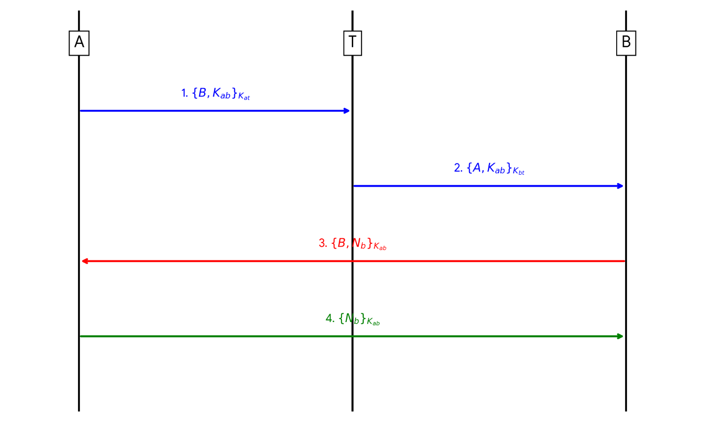

# شرح المشروع: تبادل مفتاح جلسة باستخدام SPAN وAVISPA

## فكرة المشروع

هذا مشروع جامعي لنمذجة بروتوكول يوزّع مفتاح جلسة بين Alice (A) وBob (B) عن طريق خادم موثوق T. كتبت البروتوكول بلغة HLPSL، واستخدم التقرير أداتي SPAN وAVISPA لعرض خطواته وفحص أهداف الأمان.

الهدف هو إنشاء مفتاح جديد `Kab` لاستخدامه بين A وB، ثم التحقق أن الطرف الآخر يستطيع استخدامه فعلاً.

## المفاتيح والأطراف

- `A` و`B`: الطرفان اللذان يريدان التواصل.
- `T`: الخادم الموثوق الذي يعرف المفتاحين المشتركين مع الطرفين.
- `Kat`: مفتاح طويل الأمد مشترك بين A وT.
- `Kbt`: مفتاح طويل الأمد مشترك بين B وT.
- `Kab`: مفتاح الجلسة الجديد بين A وB.
- `Nb`: قيمة عشوائية جديدة يولّدها B كتحدٍّ لإثبات حداثة الجلسة.

## تسلسل الرسائل

الرمز `{M}_K` يعني تشفير الرسالة `M` بالمفتاح `K`.

1. **A → T:** ترسل A `{B, Kab}_Kat`. وجود اسم B يربط المفتاح بالطرف المقصود.
2. **T → B:** يرسل الخادم `{A, Kab}_Kbt`. وجود اسم A يوضح لبوب مصدر المفتاح.
3. **B → A:** يولّد B قيمة عشوائية `Nb` ويرسل `{B, Nb}_Kab`.
4. **A → B:** بعد فك الرسالة، تعيد A التحدي على شكل `{Nb}_Kab`. هذا يبيّن أنها استطاعت استخدام `Kab` وأن التحدي الحالي وصل إليها.

## أهداف الفحص في الكود

- `secrecy_of sec_1`: يفحص أن `Kab` لا يتسرّب إلى المهاجم. النموذج يعلن أن A وB والخادم T أطراف مسموح لها بمعرفة المفتاح.
- `authentication_on auth_1`: يربط طلب A للتحقق من الاتفاق على `Kab` بإشارة Bob أنه قبل المفتاح.
- `authentication_on auth_2`: يربط طلب Bob للتحقق من التحدي `Nb` بإشارة Alice أنها استخدمته في ردها.

البيئة تشغّل جلستين عاديتين بالتوازي، ثم جلسة يحاول فيها المهاجم `i` انتحال A أمام B، وجلسة تكون فيها A متصلة بالمهاجم. القنوات من نوع `channel(dy)`، أي أن المهاجم يستطيع مراقبة الرسائل ومحاولة إعادة إرسالها أو تمريرها وفق نموذج Dolev–Yao.

## حالة التحقق

هذا المستودع يشرح البروتوكول وأهداف الأمان، ولا يعلن نتيجة نهائية لتحليل AVISPA. ملف HLPSL المنفصل لم يكن ضمن الملفات المستلمة؛ لذلك أُعيد تكوين `protocol.hlpsl` من قائمة الكود الكاملة داخل التقرير. شغّل هذه النسخة في SPAN/AVISPA، ثم سجّل إصدار الأداة والـbackend والإعدادات والنتيجة قبل كتابة أي استنتاج عن الفحص.

## ملاحظات تقنية

- الكود ينشئ `Na` في دور Alice لكنه لا يستخدمه في أي رسالة أو هدف؛ لذلك لا يضيف حماية فعلية بصورته الحالية.
- النموذج يفترض تشفيراً رمزياً مثالياً، ومفاتيح طويلة الأمد غير مخترقة، وخادماً موثوقاً. تحليل النموذج وحده لا يثبت أمان تطبيق برمجي مبني على الفكرة.

## الملفات

- [`protocol.hlpsl`](../protocol.hlpsl): مواصفة HLPSL المستخرجة.
- [`PROJECT_REPORT_AR.docx`](PROJECT_REPORT_AR.docx): تقرير عربي منسق للمشروع.
- [`evidence/protocol-sequence.png`](evidence/protocol-sequence.png): مخطط الرسائل.
